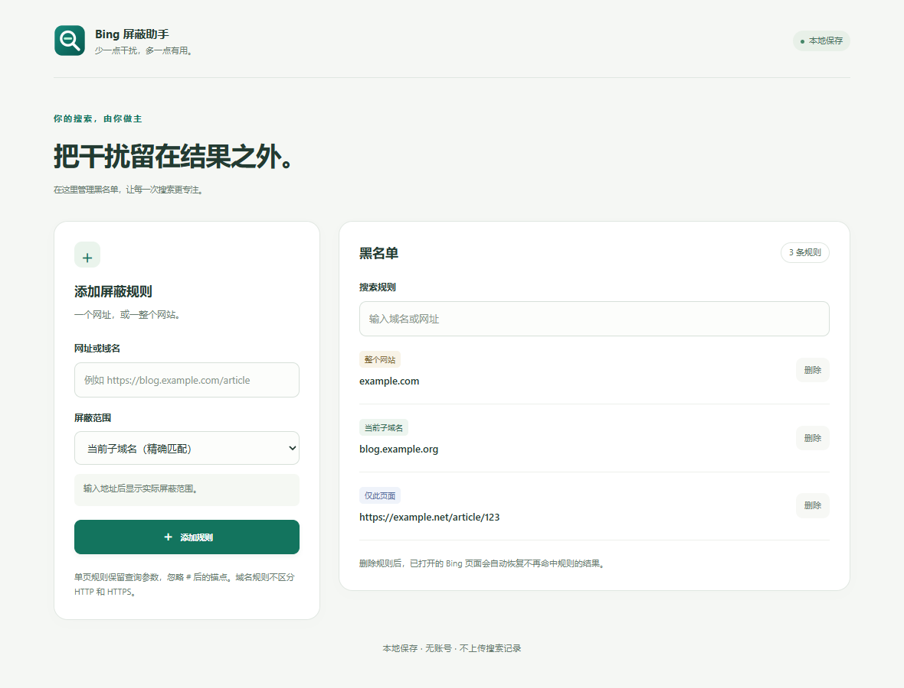

# Bing Blocker

[简体中文](README.md) · [Contributing](CONTRIBUTING.md) · [MIT License](LICENSE)

A lightweight Chromium extension that hides unwanted Bing web search results by page URL, exact hostname, or registrable domain. Rules stay in your browser. No account, backend, telemetry, or remote scripts.



## Install

Download this repository via **Code → Download ZIP** and extract it, or clone it:

```sh
git clone https://github.com/TeaCaddy/bing-blocker.git
```

Open `chrome://extensions` or `edge://extensions`, enable Developer mode, choose **Load unpacked**, and select the directory containing `manifest.json`. Refresh existing Bing tabs. No build step or Node.js installation is required for using the extension. The interface is currently in Simplified Chinese.

To update, pull or replace files **in the same directory**, reload the extension, and refresh Bing. Do not uninstall first: uninstalling deletes local rules. Changing the directory can change an unpacked extension's identity.

## Usage

Click “屏蔽” below a result title, then select:

| Choice | Behavior |
| --- | --- |
| 仅此页面 / Page | Exact URL, preserving protocol and query parameters, ignoring fragments |
| 当前子域名 / Host | Exact hostname only |
| 整个网站 / Site | Registrable domain and all its subdomains, respecting public and private suffixes |

The toolbar popup supports manual additions. “管理黑名单” opens the searchable rule manager. Removing rules restores results that no longer match any remaining rule. Missing URL schemes default to HTTPS.

Supported pages: HTTPS web searches at `www.bing.com/search` and `cn.bing.com/search`. Image/video search, AI answers, ads and special cards are outside the intended scope. Common Bing `/ck/a` redirects are decoded; unresolved links are skipped. Bing layout changes may require an extension update. Filtering does not block navigation or fetch replacement results.

## Privacy

Only the `storage` API permission and content scripts on the two Bing search hosts are declared. Rules use `chrome.storage.local`; there is no sync, import or export. See [PRIVACY.md](PRIVACY.md) for details.

## Development

Use Node.js 22 or a newer supported version:

```sh
npm ci
npx playwright install chromium
npm test
```

On Linux CI, use `npx playwright install --with-deps chromium`. Tests include six rule tests and one real-extension Chromium integration test using intercepted Bing fixtures and an isolated profile. Screenshots are written to the ignored `tests/artifacts/` directory. The CI workflow runs the same suite.

See [CONTRIBUTING.md](CONTRIBUTING.md), [CHANGELOG.md](CHANGELOG.md), and [SECURITY.md](SECURITY.md). `private: true` prevents accidental npm publication; it does not control repository visibility.

## License

[MIT](LICENSE). Third-party licenses are listed in [THIRD_PARTY_NOTICES.md](THIRD_PARTY_NOTICES.md). This is an independent project, not affiliated with Microsoft, Bing, or Google.
