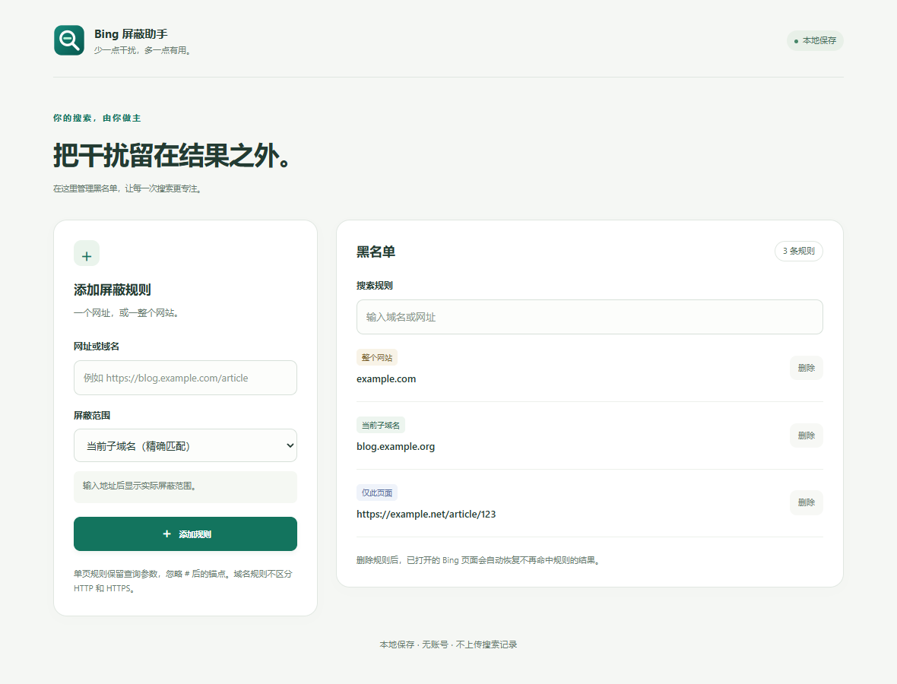

<p align="center"></p>

# Bing 屏蔽助手

让 Bing 搜索结果少一点干扰。一个轻量的 Chrome / Edge 扩展，按单个页面、当前子域名或整个网站隐藏搜索结果。

[English](README.en.md) · [安装](#安装) · [贡献指南](CONTRIBUTING.md) · [更新记录](CHANGELOG.md) · [MIT 许可证](LICENSE)



## 功能

- **结果旁直接屏蔽**：点击“屏蔽”，选择范围并查看实际匹配地址。
- **手动管理**：通过工具栏弹窗添加规则，在管理页搜索、删除规则。
- **即时过滤**：命中的整条结果消失，不留占位；翻页和动态加载后继续过滤。
- **撤销恢复**：删除规则后，已打开页面中不再命中其他规则的结果自动恢复。
- **本地保存**：不需要账号，没有后端、统计或远程脚本，不上传搜索记录与黑名单。
- **准确区分域名**：使用本地打包的 tldts 解析公共及私有后缀，识别 `example.com.cn`、`foo.github.io` 等网站边界。

## 安装

当前提供源码加载方式，无需安装 Node.js，也无需构建。

1. 在仓库首页选择 **Code → Download ZIP**，解压到准备长期保留的目录；也可以克隆仓库：

   ```sh
   git clone https://github.com/TeaCaddy/bing-blocker.git
   ```

2. 在 Chrome 地址栏输入 `chrome://extensions`，或在 Edge 输入 `edge://extensions`。
3. 开启“开发者模式”，点击“加载已解压的扩展程序”。
4. 选择包含 `manifest.json` 的目录。下载 ZIP 后目录名可能为 `bing-blocker-main`。
5. 刷新 Bing 搜索页。可将扩展固定在浏览器工具栏，方便添加和管理规则。

加载后请保留该目录。其他 Chromium 浏览器可尝试相同方式，但尚未逐一验证。

### 更新

在原目录执行 `git pull --ff-only`，或用新版本文件覆盖原目录。然后在扩展管理页点击“重新加载”，并刷新 Bing 页面。

**请保留原加载路径，不要先卸载扩展。** 更换路径可能改变已解压扩展的身份；卸载扩展会删除其本地规则。目前没有导入、导出或跨设备同步功能。

## 使用

搜索结果标题下方的“屏蔽”按钮提供三个范围：

| 选项 | 示例 | 匹配范围 |
| --- | --- | --- |
| 仅此页面 | `https://blog.example.com/a?q=1` | 精确网址，忽略 `#` 锚点；保留查询参数，区分 HTTP / HTTPS |
| 当前子域名 | `blog.example.com` | 精确主机名，不包含 `www.example.com` 或 `x.blog.example.com` |
| 整个网站 | `example.com` | 该域名及所有子域名 |

工具栏弹窗支持手动输入。省略协议时默认补全为 `https://`；添加前请核对预览。域名规则不区分 HTTP / HTTPS。不能直接屏蔽 `com.cn` 这样的公共后缀。

在“管理黑名单”中删除规则即可撤销。如果某个结果同时命中多条规则，需要移除全部匹配规则后才会恢复。隐藏结果不会自动补入其他结果。

## 支持范围与限制

- 支持 `https://www.bing.com/search` 和 `https://cn.bing.com/search` 的普通网页搜索结果。
- 不以图片、视频、AI 回答、广告或其他特殊卡片为过滤对象。
- 支持常见的 Bing `/ck/a` 跳转链接。无法确定目标的网址会跳过，不通过省略的展示地址猜测。
- Bing 页面结构、地区或实验版本可能不同。按钮缺失时请先刷新；仍有问题可按 [贡献指南](CONTRIBUTING.md) 提交经过脱敏的复现信息。
- 扩展只隐藏页面中的结果，不阻止访问该网站，也不修改 Bing 服务端的搜索结果。

## 权限与隐私

仅申请 `storage` API 权限，并声明在两个 Bing 搜索地址上的内容脚本。内容脚本读取结果链接并修改显示；规则存储在当前浏览器配置的 `chrome.storage.local` 中。扩展不发送网络请求，也不读取其他网站页面。详情见 [隐私说明](PRIVACY.md)。

## 开发与测试

建议使用 Node.js 22 或更新的受支持版本。运行时库已打包在 `vendor/`，开发依赖通过 npm 安装：

```sh
npm ci
npx playwright install chromium
npm test
```

Linux CI 可使用 `npx playwright install --with-deps chromium` 安装系统依赖。

测试包括 6 项规则测试和 1 项真实扩展加载的端到端测试，覆盖三种范围、跳转解析、域名边界、动态结果、删除恢复、重叠规则、刷新持久化及并发保存。浏览器测试拦截 Bing 请求并提供固定页面，不依赖在线搜索结果；使用独立浏览器配置，不接触个人黑名单。截图输出到 `tests/artifacts/`。

2026-11-14 曾对两个真实 Bing 搜索域名进行抽样验证：各识别 10 个按钮，并成功隐藏选中的结果。这不代表所有页面变体均已验证。

| 文件 | 职责 |
| --- | --- |
| `core.js` | 网址归一化、Bing 跳转解析和规则匹配 |
| `background.js` | 串行处理规则写入和删除 |
| `content.js` / `content.css` | 搜索结果按钮、范围选择与过滤 |
| `popup.html` / `options.html` / `ui.*` | 添加规则和黑名单管理 |
| `vendor/` | 本地打包的域名解析库与许可声明 |
| `tests/` | 单元测试与 Chromium 集成测试 |

`package.json` 中的 `private: true` 用于防止误发布到 npm，与 GitHub 仓库的公开状态无关。

## 贡献与许可

欢迎提交问题、文档修正和 PR。开始前请阅读 [贡献指南](CONTRIBUTING.md)；安全问题请遵循 [安全说明](SECURITY.md)。

本项目使用 [MIT License](LICENSE)。第三方依赖保留各自许可证，见 [第三方声明](THIRD_PARTY_NOTICES.md)。

这是独立社区项目，与 Microsoft、Bing 或 Google 没有隶属或背书关系。
